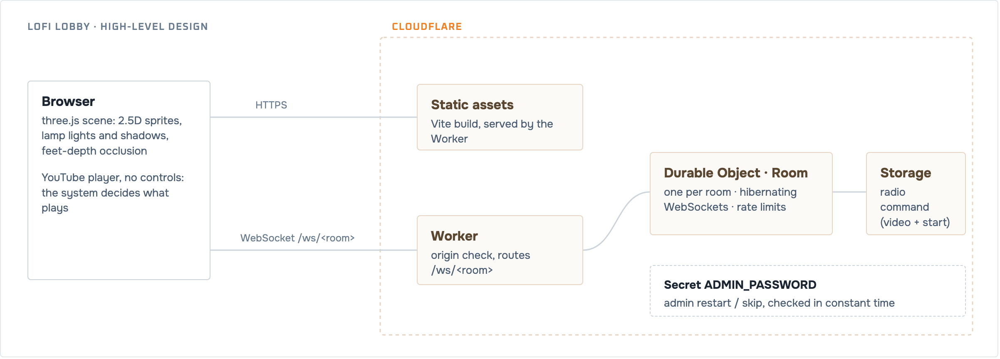

# Architecture (v1)

The low-level design: every component, how it works and the decision behind it. The [README](README.md) has the simplified view.



| Concern | How | Decision |
|---|---|---|
| Hosting | One **Worker** serves the Vite build as static assets and routes `/ws/<room>`; no other server | [ADR 001](docs/adr/001-one-durable-object-per-room.md) |
| Rooms | One **Durable Object per room**, WebSocket Hibernation API; each player's state lives in its own socket (`serializeAttachment`) | [ADR 001](docs/adr/001-one-durable-object-per-room.md) |
| Music | YouTube player with no controls; position = clock time since a fixed start, or since the last admin command kept in the object's storage | [ADR 002](docs/adr/002-radio-synced-by-the-clock.md) |
| Rendering | three.js: sprites as lit planes in a 3D scene, real shadows from each lamp, **every sprite pixel takes the depth of the feet** | [ADR 003](docs/adr/003-sprites-take-the-depth-of-the-feet.md) |
| Assets | The repo and the live site ship only **original art generated in code**; local files in `public/assets/` are ignored by Git and by the build | [ADR 004](docs/adr/004-original-art-in-the-repo-local-assets-ignored.md) |
| Admin | Secret `ADMIN_PASSWORD`, checked in the room object in constant time, few tries per connection | [SECURITY.md](SECURITY.md) |

**Limits of this design.** A room is one object, so it holds a few dozen players (capped at 40); more people means more rooms, not a bigger one. Positions are relayed, not simulated on the server, so a modified client can teleport; nothing in the lobby is worth cheating for. The YouTube player can't be hidden or fully controlled (ads, embeds disabled by the owner): those videos are skipped.

The full design, with the protocol and the sync rules, is in the [v1 spec](docs/spec/v1.md).

## Repository

```
index.html          HUD: room box, radio, chat, entry screen (glass over the scene)
src/
  main.js           scene, lights, water, original town and trainers, collision,
                    feet-depth occlusion, chat bubbles, name tags, multiplayer client
  radio.js          YouTube player synced by the clock or by the room's radio command
worker/index.js     Worker (static assets + /ws routing) and the Room Durable Object
scripts/            deploy-your-own, README image rendering
docs/               PRD, spec, ADRs, README images
```

The README images come from [`docs/assets/banner.html`](docs/assets/banner.html) and [`docs/assets/hld.html`](docs/assets/hld.html), rendered by [`scripts/render-docs.sh`](scripts/render-docs.sh).
