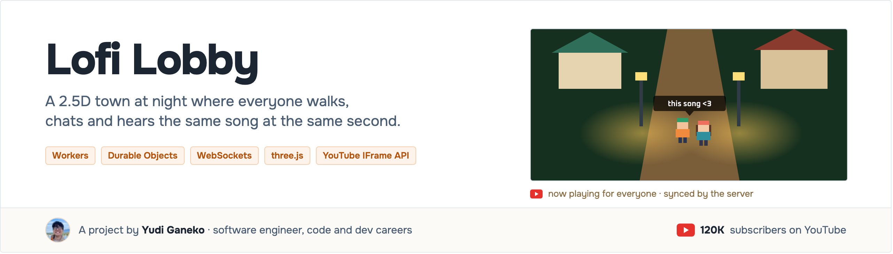
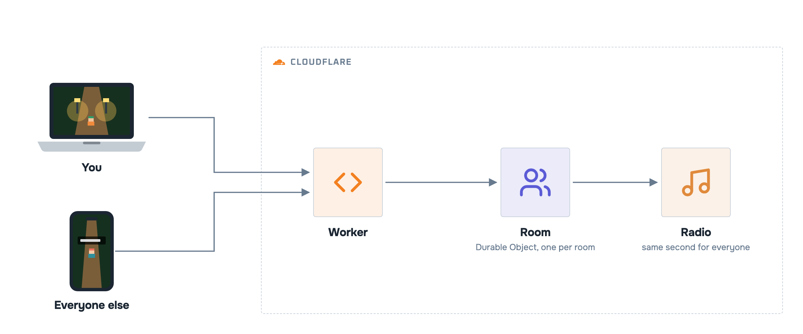
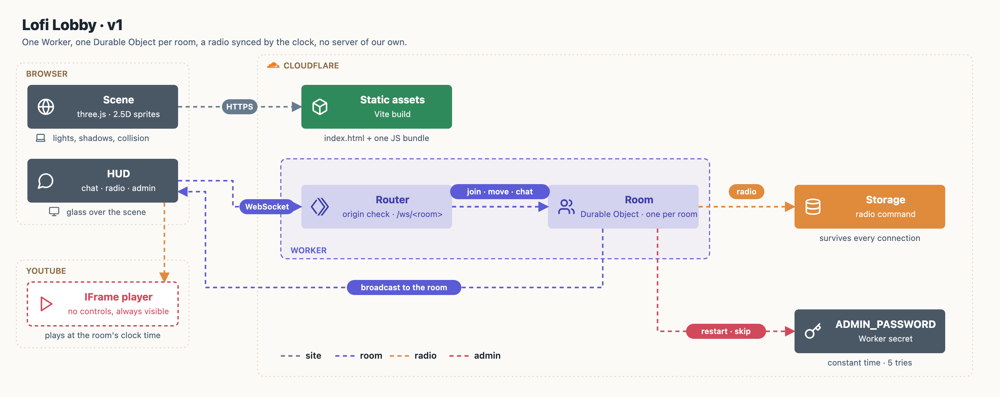

<p align="center"><a href="https://www.youtube.com/@yudiganeko"></a></p>

<p align="center">    <a href="LICENSE"></a></p>

**A 2.5D town at night that you leave open while you study or work**: walk around, chat with a bubble over your head, and hear the same YouTube song as everyone else, at the same second. The system picks the song, like a radio.

Live: **[lofi-lobby.yudiganeko.workers.dev](https://lofi-lobby.yudiganeko.workers.dev)**

<p align="center"></p>

<p align="center"><sub>A simplified view. Every component, with the decision behind it: <a href="#architecture">Architecture</a>.</sub></p>

## Deploy your own

Needs a Cloudflare account (the free plan is enough) and Node 20 or later.

```sh
git clone https://github.com/YudiG12/lofi-lobby && cd lofi-lobby
npm ci && npm run deploy-your-own
```

Or ask your AI coding agent:

```txt
Clone https://github.com/YudiG12/lofi-lobby and deploy it for me, following its AGENTS.md.
```

## How to use

Open the URL, pick a trainer and press **enter the room**: the click is what lets the browser play sound.

| Key | Does |
|---|---|
| Arrows / WASD | walk (Shift runs) |
| M or the speaker button | mute the radio for you |
| Phone: drag anywhere | walk (push to the edge of the ring to run); **chat** button opens the chat |
| Enter | open the chat; it stays open after sending · Esc or Enter on an empty box goes back to walking |
| @ in the chat | mention someone in the room (Tab or Enter picks the name); everyone reads it, but it is highlighted for them |
| G | switch trainer |
| T by the pond | skip a stone on the water (everyone sees it) |
| C, or the sitting button | sit on the ground, facing the way you stand (any move gets you up) |
| N or the day/night button | switch between night, day and automatic day/night cycle for you |
| R or the rain button | turn the rain on or off for you (greyer sky by day) |
| F or the full screen button | enter or leave full screen (hidden where the browser can't, e.g. iPhone) |
| B, or E (or a tap on the note) by the board | open the message wall: read the notes, like them and pin your own (most liked first, or newest) |
| E (or a tap on the note) at the pond's edge, facing the water | fish: choose how many minutes to focus; when the time is up a fish bites and you have a minute to press E again and pull it in (everyone sees your line out; the timer is yours) |
| Space | pause the music for you only |

- There is one room, `lobby`, for everyone (the server refuses any other name).
- Contributors: type `/github` in the chat and type the code it shows at github.com/login/device. The room learns your GitHub login and shows a badge with your merged pull requests (`/github out` forgets it). For a deploy of your own, create a GitHub OAuth App with "Enable Device Flow" on and put its Client ID in `GITHUB_CLIENT_ID` and your repository in `GITHUB_REPO` (`wrangler.toml`); no secret is needed.
- Admin: type `/admin` in the chat and enter the password in the login box (`ADMIN_PASSWORD`); `/logout` leaves. Then you can restart or skip the song for everyone, and click a player's name (above them or in the chat) to kick or ban them, and delete notes on the message wall (the ✕ on a note); `/unban` in the chat lifts every ban.
- Change the song list in [`src/radio.js`](src/radio.js) (`LISTA`, YouTube video ids).

## Architecture



| Concern | How | Decision |
|---|---|---|
| Hosting | One **Worker** serves the Vite build as static assets and routes `/ws/<room>`; no other server | [ADR 001](docs/adr/001-one-durable-object-per-room.md) |
| Rooms | One **Durable Object per room**, WebSocket Hibernation API; each player's state lives in its own socket (`serializeAttachment`) | [ADR 001](docs/adr/001-one-durable-object-per-room.md) |
| Music | YouTube player with no controls; position = clock time since a fixed start, or since the last admin command kept in the object's storage | [ADR 002](docs/adr/002-radio-synced-by-the-clock.md) |
| Rendering | three.js: sprites as lit planes in a 3D scene, real shadows from each lamp, **every sprite pixel takes the depth of the feet** | [ADR 003](docs/adr/003-sprites-take-the-depth-of-the-feet.md) |
| Assets | The repo and live site include the **Twinleaf FBX town, its textures and both trainer sheets** from `public/assets/`; code-generated fallbacks remain for load failures | [ADR 005](docs/adr/005-version-and-deploy-game-assets.md) |
| Presence | `pagehide` beacon (`/api/leave` with per-socket token), zero-wake `ping`/`pong` heartbeat + DO `alarm()`, and strict pre-`hello` gating | [ADR 006](docs/adr/006-reliable-disconnect-and-stale-socket-cleanup.md) |
| Day / night / auto | Client-side 3-state switch (`night`, `day`, `auto`): 10-minute keyframed cycle (`DEFAULT_CYCLE_MS` in `src/main.js`), persisted in `localStorage`; dev-only module in `src/cycle-debug.js` | [ADR 008](docs/adr/008-client-side-day-night-cycle.md) |
| Town cats | Five clock-synced procedural cats roaming a whole-town BFS NavGrid (`src/cat.js`), fed with `E`, with DO heartbeat lottery for head-perching (`worker/index.js`) | [ADR 009](docs/adr/009-free-roaming-town-cats-and-head-perching.md) |
| Debug hub | Single dev-only `import.meta.env.DEV` hub (`src/debug.js`) behind one toolbar bug button, hosting modular debug views (`src/cat-debug.js`, `src/cycle-debug.js`) and stripped from production builds | [ADR 010](docs/adr/010-dev-only-modular-debug-hub.md) |
| Carousel | Built in code where pines are taken out of the town as it loads; turned by the room's clock (`roomNow()`), so its horses are just seats 16..23 and riding sends no messages; nothing that turns casts a shadow | [ADR 011](docs/adr/011-christmas-carousel.md) |
| Ferris wheel and fair lamps | The carousel's pattern right of the pond: gondolas are seats 24..31, boarded only near the bottom, placed upright each frame from the room's clock; four lamps around the rides whose light casts no shadow | [ADR 012](docs/adr/012-ferris-wheel-and-fair-lamps.md) |
| Message wall | Notes go over HTTP (`/api/notes`), not the WebSocket, and live in the room object's storage: **one key per note**, so the wall has no size limit and is read a page at a time | [SECURITY.md](SECURITY.md) |
| Admin | Secret `ADMIN_PASSWORD`, checked in the room object in constant time, few tries per connection | [SECURITY.md](SECURITY.md) |

**Limits of this design.** There is a single room (`lobby`), and a room is one object, so it holds a few dozen players (capped at 100); growing past that would mean opening more rooms, not a bigger one. Positions are relayed, not simulated on the server, so a modified client can teleport; nothing in the lobby is worth cheating for. The YouTube player can't be hidden or fully controlled (ads, embeds disabled by the owner): those videos are skipped.

The full design, with the protocol and the sync rules, is in the [v1 spec](docs/spec/v1.md).

### Repository

```
index.html          HUD: room box, radio, chat, entry screen (glass over the scene)
src/
  main.js           scene, lights, water, asset loading and code-generated fallbacks,
                    collision, chat bubbles, name tags, multiplayer client
  cat.js            procedural pixel-art town cats (5 coats, walk, eat, 4-dir head perch)
  debug.js          dev-only modular debug hub (stripped from production builds)
  cat-debug.js      dev-only cat & NavGrid debug module (stripped from production builds)
  cycle-debug.js    dev-only cycle debug module (stripped from production builds)
  radio.js          YouTube player synced by the clock or by the room's radio command
public/assets/      Twinleaf FBX model, textures and male/female trainer sheets
worker/index.js     Worker (static assets + /ws routing) and the Room Durable Object
scripts/            deploy-your-own, README image rendering
docs/               PRD, spec, ADRs, README images and real gameplay screenshot
```

The map is generated by [`docs/architecture/draw.py`](docs/architecture/draw.py); the README images come from [`docs/assets/banner.html`](docs/assets/banner.html) and [`docs/assets/hld.html`](docs/assets/hld.html), rendered by [`scripts/render-docs.sh`](scripts/render-docs.sh).

## Links

- [Decisions (ADRs)](docs/adr/) · [Spec v1](docs/spec/v1.md) · [PRD v1](docs/prd/v1.md)
- [CHANGELOG](CHANGELOG.md) · [Contributing](CONTRIBUTING.md) · [Security](SECURITY.md) · [MIT license](LICENSE)
