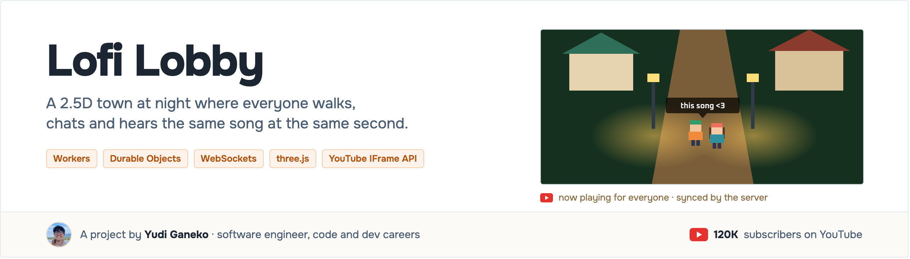

<p align="center"><a href="https://www.youtube.com/@yudiganeko"></a></p>

<p align="center">    <a href="LICENSE"></a></p>

**A 2.5D town at night that you leave open while you study or work**: walk around, chat with a bubble over your head, and hear the same YouTube song as everyone else, at the same second. The system picks the song, like a radio.

Live: **[lofi-lobby.yudiganeko.workers.dev](https://lofi-lobby.yudiganeko.workers.dev)**

<p align="center"></p>

<p align="center"><sub>A simplified view. Every component, with the decision behind it: <a href="ARCHITECTURE.md">ARCHITECTURE.md</a>.</sub></p>

## Deploy your own

Needs a Cloudflare account (the free plan is enough) and Node 20 or later.

```sh
git clone https://github.com/YudiG12/lofi-lobby && cd lofi-lobby
npm ci && npm run deploy-your-own
```

Or ask your AI coding agent:

```txt
Clone https://github.com/YudiG12/lofi-lobby and deploy it for me, following its AGENTS.md.
```

## How to use

Open the URL, pick a trainer and press **enter the room**: the click is what lets the browser play sound.

| Key | Does |
|---|---|
| Arrows / WASD | walk (Shift runs) |
| Enter | open the chat · Esc leaves it |
| G | switch trainer |
| Space | pause the music for you only |

- Another room: `?room=<name>`. Each name is its own Durable Object.
- Admin (restart or skip the song for everyone): open once with `?admin=<ADMIN_PASSWORD>`.
- Change the song list in [`src/radio.js`](src/radio.js) (`LISTA`, YouTube video ids).

## Links

- [ARCHITECTURE.md](ARCHITECTURE.md): the low-level design, every component with the decision behind it
- [Decisions (ADRs)](docs/adr/) · [Spec v1](docs/spec/v1.md) · [PRD v1](docs/prd/v1.md)
- [CHANGELOG](CHANGELOG.md) · [Contributing](CONTRIBUTING.md) · [Security](SECURITY.md) · [MIT license](LICENSE)
