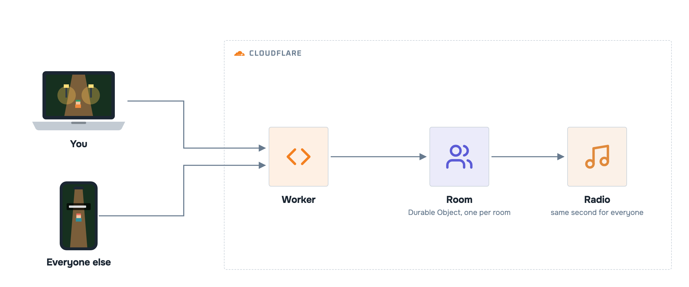
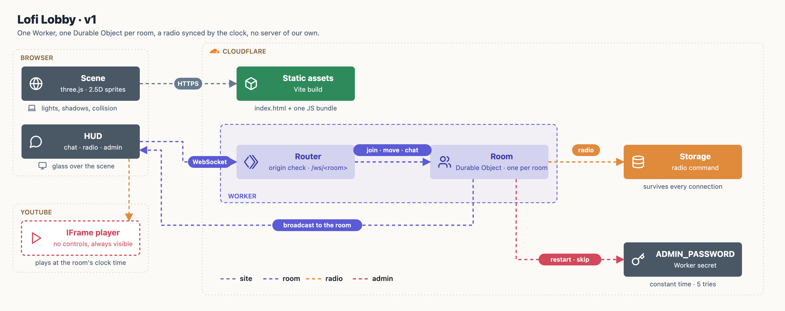

<p align="center"><a href="https://www.youtube.com/@yudiganeko"></a></p>

<p align="center">    <a href="LICENSE"></a></p>

**A 2.5D town at night that you leave open while you study or work**: walk around, chat with a bubble over your head, and hear the same YouTube song as everyone else, at the same second. The system picks the song, like a radio.

Live: **[lofi-lobby.yudiganeko.workers.dev](https://lofi-lobby.yudiganeko.workers.dev)**

<p align="center"></p>

<p align="center"><sub>A simplified view. Every component, with the decision behind it: <a href="#architecture">Architecture</a>.</sub></p>

## Deploy your own

Needs a Cloudflare account (the free plan is enough) and Node 20 or later.

```sh
git clone https://github.com/YudiG12/lofi-lobby && cd lofi-lobby
npm ci && npm run deploy-your-own
```

Or ask your AI coding agent:

```txt
Clone https://github.com/YudiG12/lofi-lobby and deploy it for me, following its AGENTS.md.
```

## How to use

Open the URL, pick a trainer and press **enter the room**: the click is what lets the browser play sound.

| Key | Does |
|---|---|
| Arrows / WASD | walk (Shift runs) |
| M or the speaker button | mute the radio for you |
| Phone: drag anywhere | walk (push to the edge of the ring to run); **chat** button opens the chat |
| Enter | open the chat · Esc leaves it |
| G | switch trainer |
| Space | pause the music for you only |

- There is one room, `lobby`, for everyone (the server refuses any other name).
- Admin (restart or skip the song for everyone): open once with `?admin=<ADMIN_PASSWORD>`.
- Change the song list in [`src/radio.js`](src/radio.js) (`LISTA`, YouTube video ids).

## Architecture



| Concern | How | Decision |
|---|---|---|
| Hosting | One **Worker** serves the Vite build as static assets and routes `/ws/<room>`; no other server | [ADR 001](docs/adr/001-one-durable-object-per-room.md) |
| Rooms | One **Durable Object per room**, WebSocket Hibernation API; each player's state lives in its own socket (`serializeAttachment`) | [ADR 001](docs/adr/001-one-durable-object-per-room.md) |
| Music | YouTube player with no controls; position = clock time since a fixed start, or since the last admin command kept in the object's storage | [ADR 002](docs/adr/002-radio-synced-by-the-clock.md) |
| Rendering | three.js: sprites as lit planes in a 3D scene, real shadows from each lamp, **every sprite pixel takes the depth of the feet** | [ADR 003](docs/adr/003-sprites-take-the-depth-of-the-feet.md) |
| Assets | The repo and live site include the **Twinleaf FBX town, its textures and both trainer sheets** from `public/assets/`; code-generated fallbacks remain for load failures | [ADR 005](docs/adr/005-version-and-deploy-game-assets.md) |
| Admin | Secret `ADMIN_PASSWORD`, checked in the room object in constant time, few tries per connection | [SECURITY.md](SECURITY.md) |

**Limits of this design.** A room is one object, so it holds a few dozen players (capped at 100); more people means more rooms, not a bigger one. Positions are relayed, not simulated on the server, so a modified client can teleport; nothing in the lobby is worth cheating for. The YouTube player can't be hidden or fully controlled (ads, embeds disabled by the owner): those videos are skipped.

The full design, with the protocol and the sync rules, is in the [v1 spec](docs/spec/v1.md).

### Repository

```
index.html          HUD: room box, radio, chat, entry screen (glass over the scene)
src/
  main.js           scene, lights, water, asset loading and code-generated fallbacks,
                    collision, chat bubbles, name tags, multiplayer client
  radio.js          YouTube player synced by the clock or by the room's radio command
public/assets/      Twinleaf FBX model, textures and male/female trainer sheets
worker/index.js     Worker (static assets + /ws routing) and the Room Durable Object
scripts/            deploy-your-own, README image rendering
docs/               PRD, spec, ADRs, README images and real gameplay screenshot
```

The map is generated by [`docs/architecture/draw.py`](docs/architecture/draw.py); the README images come from [`docs/assets/banner.html`](docs/assets/banner.html) and [`docs/assets/hld.html`](docs/assets/hld.html), rendered by [`scripts/render-docs.sh`](scripts/render-docs.sh).

## Links

- [Decisions (ADRs)](docs/adr/) · [Spec v1](docs/spec/v1.md) · [PRD v1](docs/prd/v1.md)
- [CHANGELOG](CHANGELOG.md) · [Contributing](CONTRIBUTING.md) · [Security](SECURITY.md) · [MIT license](LICENSE)
